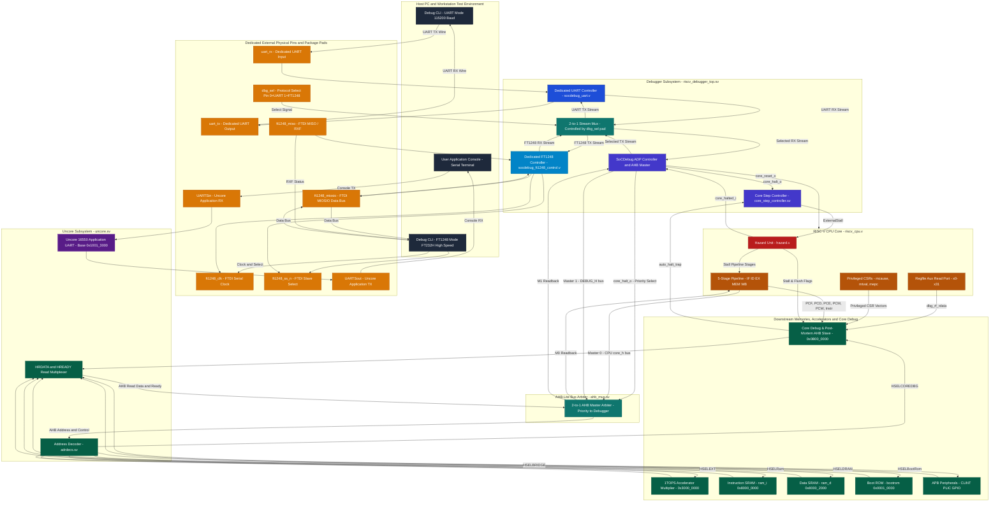

# CORE-V Wally RISC-V SoC: Complete Dual-Protocol Debugger Wiring Guide & Architecture

This specification details the comprehensive pin-by-pin wiring connection map, hardware multiplexing architecture, and signal specification for the **SoCDebug Subsystem** integrated into the **CORE-V Wally RISC-V SoC** (`1tops_soc`).

The subsystem features **Dual-Protocol Hardware Interface Integration**:
1. **Dedicated Debugger UART Transceiver** (`socdebug_uart.v`) with independent external serial pins (`uart_rx`, `uart_tx`).
2. **Dedicated FT1248 High-Speed Synchronous Transceiver** (`socdebug_ft1248_control.v`) with independent external pins (`ft1248_clk`, `ft1248_ss_n`, `ft1248_miso`, `ft1248_miosio`).
3. **Physical Protocol Select Pin (`dbg_sel`)**: A dedicated real input pad on hardware controlling an internal 2-to-1 AXI-Stream multiplexer.
4. **Separate Uncore 16550 Application UART** (`uartPC16550D.sv` / `uart_apb.sv`) connected independently to `UARTSin` and `UARTSout` for runtime software logs.
5. **ASCII Debug Protocol (ADP) Controller & AHB Master** (`socdebug_adp_control.v` / `socdebug_ahb.v`).
6. **RISC-V CPU Pipeline Hazard Unit & Stall Hooks** (`hazard.sv` / `wallypipelinedcore.sv`).
7. **2-Master AHB-Lite Bus Arbiter & Multiplexer** (`ahb_mux.sv`).
8. **Downstream Slaves & Memories**: 1TOPS Accelerator Multiplier, IRAM, DRAM, Boot ROM, APB Bridge.
9. **Core Debug & Post-Mortem AHB Slave** (`core_debug_ahb.v` at Base `0x0B00_0000`): Non-intrusive direct readout of GPRs `x0`–`x31`, privileged CSRs, pipeline PCs, 16-entry micro-trace buffer, and hardware auto-halt trap freeze.

---

## 1. Top-Level Architectural Block Diagram



---

## 2. Dedicated Physical Pinout Specification

Each protocol interface has its own independent external pins connected to real chip package pads. The physical pad `dbg_sel` switches which transceiver drives the internal ADP core:

| Pin Name | Width | Direction | Pad Type | Default | Functional Description |
| :--- | :---: | :---: | :---: | :---: | :--- |
| **`dbg_sel`** | 1 | Input | CMOS In (Pull-Down) | `0` | **Physical Protocol Selection Pad**:<br/>- `0` (LOW) = Dedicated UART Active, FT1248 Isolated.<br/>- `1` (HIGH) = Dedicated FT1248 Active, UART Isolated. |
| **`uart_rx`** | 1 | Input | CMOS In (Pull-Up) | `1` | **Dedicated Debugger UART RX**: Serial receive from host CLI. |
| **`uart_tx`** | 1 | Output | Push-Pull Out | `1` | **Dedicated Debugger UART TX**: Serial transmit to host CLI. |
| **`ft1248_clk`** | 1 | Output | Push-Pull Out | `0` | **FT1248 Serial Clock (SCLK)**: Driven by SoC to FTDI slave device. |
| **`ft1248_ss_n`** | 1 | Output | Push-Pull Out | `1` | **FT1248 Slave Select (SS#)**: Active-low chip select driven by SoC. |
| **`ft1248_miso`** | 1 | Input | CMOS In (Pull-Up) | `1` | **FT1248 MISO / RXF#**: Driven by FTDI device (low = data ready to read). |
| **`ft1248_miosio`** | 1 (or 4, 8) | Inout | Bidirectional Tristate | `Z` | **FT1248 MIOSIO Data**: Bidirectional data bus. In idle, bit 0 reflects TXE# (low = FTDI write FIFO ready). |
| **`UARTSin`** | 1 | Input | CMOS In (Pull-Up) | `1` | **Uncore Application UART RX**: Dedicated to user software runtime terminal (tied high in top-wrapper). |
| **`UARTSout`** | 1 | Output | Push-Pull Out | `1` | **Uncore Application UART TX**: Dedicated to user software runtime terminal. |
| **`led_core_halted`** | 1 | Output | Push-Pull Out | `0` | **Core Halted Indicator (LED 0, Pin U16)**: Lit when CPU pipeline is frozen (`core_halt_o = 1`). |
| **`led_dbg_sel`** | 1 | Output | Push-Pull Out | `0` | **Protocol Indicator (LED 1, Pin E19)**: Reflects `dbg_sel` mode (OFF = UART, ON = FT1248). |
| **`led_rx_detect`** | 1 | Output | Push-Pull Out | `0` | **UART RX Monitor & Prompt Detector (LED 15, Pin L1)**: Pulses ~200ms on any valid byte; latches ON upon detecting prompt `]`. |

---

## 3. Protocol Isolation & 2-to-1 Multiplexer Operation

The 2-to-1 stream multiplexer resides inside [`riscv_debugger_top.sv`](file:///home/23EC01043/Desktop/cores/Ganesh_CVW/cvw/1tops_soc/src2/debugger/riscv_debugger_top.sv) and guarantees complete electrical and functional isolation:

```verilog
assign adp_rx_data  = (dbg_sel == 1'b0) ? uart_adp_rx_data  : ft_adp_rx_data;
assign adp_rx_valid = (dbg_sel == 1'b0) ? uart_adp_rx_valid : ft_adp_rx_valid;

assign uart_adp_rx_ready = (dbg_sel == 1'b0) ? adp_rx_ready : 1'b0;
assign ft_adp_rx_ready   = (dbg_sel == 1'b1) ? adp_rx_ready : 1'b0;

assign uart_adp_tx_data  = adp_tx_data;
assign uart_adp_tx_valid = (dbg_sel == 1'b0) ? adp_tx_valid : 1'b0;

assign ft_adp_tx_data    = adp_tx_data;
assign ft_adp_tx_valid   = (dbg_sel == 1'b1) ? adp_tx_valid : 1'b0;

assign adp_tx_ready = (dbg_sel == 1'b0) ? uart_adp_tx_ready : ft_adp_tx_ready;
```

### Isolation Guarantees:
- **When `dbg_sel = 0` (UART Mode)**:
  - UART RX stream feeds ADP; UART TX stream receives ADP output.
  - FT1248 RX ready is forced to `0`; FT1248 TX valid is forced to `0`.
  - The FT1248 interface is held quiet in idle without bus contention.
- **When `dbg_sel = 1` (FT1248 Mode)**:
  - FT1248 RX stream feeds ADP; FT1248 TX stream receives ADP output.
  - UART RX ready is forced to `0`; UART TX valid is forced to `0`.
  - External UART traffic cannot corrupt or inject commands into ADP while FT1248 is active (verified in testbench Part 3).

---

## 4. Pipeline Freeze, Hazard Unit & Step Controller (`core_step_controller.sv`)

To control CPU execution deterministically:
1. Debugger asserts **`core_halt_o = 1`** via ADP command `C 0202\n`.
2. The **Step Controller FSM** (`core_step_controller.sv`) manages `ExternalStall` into `hazard.sv`.
3. When halted, `hazard.sv` raises pipeline stall signals: `StallF = 1`, `StallD = 1`, `StallE = 1`, `StallM = 1`, `StallW = 1`.
4. Program Counter (`PCF`), instruction fetch, and writeback registers freeze in place.
5. `hazard.sv` returns `core_halted_i = 1` feedback to the debugger.
6. When halted, `ahb_mux.sv` grants exclusive, uninterrupted bus priority to the debugger master.

### 4.1 Deterministic Single-Stepping Modes
The `core_step_controller` supports two hardware-controlled single-stepping modes:
- **Instruction Step Mode (`C 0204\n`)**: Temporarily un-stalls the core until **`InstrRetired = 1`** (`InstrValidM & ~StallW & ~FlushW` in `wallypipelinedcore.sv`), then immediately re-asserts `ExternalStall` and pulses `step_done`. This executes exactly 1 retired instruction.
- **Clock-Cycle Step Mode (`C 020c\n`)**: Temporarily un-stalls the core for **exactly 1 clock cycle**, advancing the pipeline by 1 tick, then immediately re-freezes.
- **Safety Watchdog**: An internal counter prevents debugger hang if an instruction is blocked indefinitely (default 65,536 cycles).
- **Core Resume (`C 0102\n`)**: Releases `ExternalStall` so the CPU continues running freely from where it was halted.

### 4.2 Glitch/Hazard-Free Scan-Chain Friendly Post-Mortem Debugging Architecture

The post-mortem crash analysis unit (`core_debug_ahb.v`) is designed specifically to comply with deep submicron ASIC timing, physical testability (DFT), and hazard-free asynchronous/synchronous boundaries:

1. **Scan-Chain Friendly (DFT Compliant)**:
   - **Single Clock Domain**: Operates strictly on `HCLK` synchronously with the CPU core and uncore bus fabric. No internal clock divider gates or derived clocks.
   - **Standard Resets**: Driven by active-low asynchronous system reset `HRESETn`. No internal set/reset loops.
   - **Pure Synchronous Registers**: 100% standard D flip-flops with synchronous multiplexed enables. **Zero latches, zero delay elements, zero gated clock cells.**
   - All flip-flops have controllable scan paths and predictable clock tree distribution.

2. **Glitch-Free & Hazard-Free Non-Intrusive Register Access**:
   - The CPU register file (`reg_file.v`) incorporates an auxiliary, non-intrusive 32-bit combinational read port (`dbg_rd_addr` -> `dbg_rd_data`).
   - During the AHB address phase ($N$), the AHB address bits `HADDR[6:2]` directly index `dbg_rd_addr`.
   - The register file array reads out combinationally, stabilizing before the AHB data phase ($N+1$).
   - Returns data in a single cycle (`HREADYOUT = 1`, zero wait states) without stealing pipeline read cycles, without injecting hazard stalls into the CPU, and without bus contention.

3. **Hardware Auto-Halt on Trap**:
   - When an unhandled trap or CPU exception occurs (`TrapM = 1` or `IllegalInstrD = 1`), `core_debug_ahb` asserts `auto_halt_trap = 1`.
   - This signal feeds directly into `core_step_controller.sv`, which instantaneously shifts the FSM into `STATE_HALTED` and forces `ExternalStall = 1`.
   - **Why This Matters**: Standard processors continue executing past an unhandled exception into a trap handler or infinite loop, rapidly clobbering registers and pipeline state. Hardware Auto-Halt freezes the pipeline **within the same cycle**, preserving the exact faulting PC, memory addresses, opcode, and registers at the moment of failure.

4. **Sticky Crash Capture & Circular Micro-Trace Buffer**:
   - **Sticky Latches**: `TRAP_CAUSE` (`mcause`), `TRAP_VAL` (`mtval`), and `TRAP_PC` (`PCM`) latch synchronously on the first clock edge of the trap, remaining frozen until explicitly cleared by software (`DBG_CTRL[1] = 1`).
   - **Circular Micro-Trace Buffer**: A 16-entry synchronous FIFO continuously captures the Writeback stage Program Counter (`PCW`) on every valid instruction retirement (`InstrRetired = 1`). Upon crash, it provides a 16-step historical trace of the execution path leading up to the fault.

5. **Enhanced Status Visibility (`GPI8`)**:
   - `GPI8[3]` flags `dbg_trap_latched`, allowing immediate status queries via `C` over UART or FT1248 to detect core crashes.
   - `GPI8[7:4]` reflect live hardware fault flags (`IllegalInstrD`, `MisalignD`, `MemFaultM`, `TrapM`).

---

## 5. Bus Arbiter Specification: `ahb_mux.sv`

`ahb_mux.sv` implements a 2-to-1 AHB-Lite bus arbiter connecting Master 0 (CPU Core) and Master 1 (Debugger):

```
          +---------------------------------+
M0 (CPU)  |                                 |
--------->|  ahb_mux.sv                     |
          |  - Priority when core_halt = 1  |=======> S_* (Downstream AHB Slaves)
M1 (DBG)  |  - Pipelined grant tracking     |
--------->|                                 |
          +---------------------------------+
```

- **Priority Arbitration**: When `core_halt = 1`, Master 1 (Debugger) is granted unconditional exclusive bus ownership.
- **Pipelined Tracking**: Addresses driven in phase $N$ are paired with data phases in $N+1$ via registered `grant_data`.
- **Slave Multiplexing**: Return data (`HRDATA`), `HREADY`, and `HRESP` are routed back exclusively to the granted master.

### 5.1 Subword Byte Strobe Decoding (`HWSTRB`)
In `wallypipelinedsoc.sv`, when `dbg_core_halt = 1`, write strobes are dynamically decoded according to transfer size and address offsets:
- **Word (`HSIZE = 2'b10`)**: `dbg_HWSTRB = 4'b1111`
- **Halfword (`HSIZE = 2'b01`)**: `dbg_HWSTRB = HADDR[1] ? 4'b1100 : 4'b0011`
- **Byte (`HSIZE = 2'b00`)**: `dbg_HWSTRB` decoded via `HADDR[1:0]` (`4'b0001`, `4'b0010`, `4'b0100`, `4'b1000`)
This ensures byte stream uploads (`U <count>`) write each byte accurately to its targeted byte lane without overwriting neighboring bytes in memory.

### 5.2 Glitch-Free Synchronous UART RX Monitor (`wally_soc_fpga_top.sv`)
To monitor incoming serial traffic on PMOD JA without creating combinational loops:
- Implements a 2-stage synchronizer (`rx_sync`) clocked at 50 MHz (`clk_soc`).
- Samples at the center of each bit period at 115,200 baud.
- Drives a monostable pulse stretcher (~200 ms) to flash **LED 15 (Pin L1)** upon byte reception.
- Compares each received byte to ASCII `]` (`0x5D`) and latches a sticky bit ON, providing visual indication that the ADP engine has entered command mode.

---

## 6. Complete Verification Test Matrix (`tb/tb_debugger.sv`)

The testbench compiles and executes cleanly under **QuestaSim-64 2023.4_5**:

```bash
cd /home/23EC01043/Desktop/cores/Ganesh_CVW/cvw/1tops_soc/src2/debugger
vlog -sv socdebug_adp_control.v socdebug_ahb.v socdebug_uart.v socdebug_ft1248_control.v core_step_controller.sv riscv_debugger_top.sv ahb_mux.sv ../main/soc/multiplier_ahb.v tb/f232h_ft1248_stream.v tb/tb_debugger.sv
vsim -c -do "run -all; quit" tb_debugger
```

### Verification Results Summary (20 / 20 Passed, 0 Errors):

| Test # | Protocol / Mode | Description | Verification Method | Status |
| :---: | :---: | :--- | :--- | :---: |
| **1.1** | UART (`dbg_sel = 0`) | Core Halt & Status Verification | `C 0202` halt asserted, verified via `core_halted_i` and `C` query | **PASS** |
| **1.2** | UART (`dbg_sel = 0`) | IRAM Program Code Loading | Loaded 32-bit instructions at `0x8000_0000`, verified with `R after A` | **PASS** |
| **1.3** | UART (`dbg_sel = 0`) | DRAM Sub-word & Word Access | Written `0xdeadbeef` to DRAM `0x8000_2000`, verified readback | **PASS** |
| **1.4** | UART (`dbg_sel = 0`) | 1TOPS Accelerator Multiplier | Loaded OpA=8, OpB=9 at `0x3000_0000`, readback product `72` (`0x48`) | **PASS** |
| **1.5** | UART (`dbg_sel = 0`) | Illegal Bus Address Error | Accessed `0x5000_0000`, verified `R!0x00000000` exclamation indicator | **PASS** |
| **1.6** | UART (`dbg_sel = 0`) | Core Resume | `C 0102` resume asserted, verified via `core_halt_o = 0` and `C` query | **PASS** |
| **2.1** | FT1248 (`dbg_sel = 1`)| Dynamic Hardware Pad Switch | Switched pad to `1`, halted core via FT1248 `C 0202`, verified status | **PASS** |
| **2.2** | FT1248 (`dbg_sel = 1`)| DRAM Write & Readback | Written `0x55aa55aa` to `0x8000_2000` via FT1248, verified readback | **PASS** |
| **2.3** | FT1248 (`dbg_sel = 1`)| 1TOPS Multiplier over FT1248 | OpA=15, OpB=3, readback product `45` (`0x2D`) via FT1248 | **PASS** |
| **2.4** | FT1248 (`dbg_sel = 1`)| Hardware Register Polling | Configured `M 000000ff`, `V 0000002d`, polled `P`, verified match | **PASS** |
| **2.5** | FT1248 (`dbg_sel = 1`)| Core Resume over FT1248 | Resumed core via FT1248 `C 0102`, verified running status | **PASS** |
| **3.1** | Isolation Test | UART Traffic Blocking | Sent UART commands while `dbg_sel = 1`; verified UART ignored | **PASS** |
| **3.2** | Isolation Test | Switch back to UART | Switched pad back to `0`, verified UART immediately regains control | **PASS** |
| **3.3** | System Integrity | Final Core Halt/Resume Cycle | Completed final full cycle over UART with 0 errors | **PASS** |
| **4.1** | Step Controller | Core Halt in Step FSM | `C 0202` verified in `STATE_HALTED`, `core_stall_effective = 1` | **PASS** |
| **4.2** | Step Controller | Single Instruction Stepping | `C 0204` triggers step, stalls released, retires 1 instr, auto-freezes | **PASS** |
| **4.3** | Step Controller | 1 Clock-Cycle Stepping | `C 020c` triggers 1-cycle step, executes 1 clock tick, auto-freezes | **PASS** |
| **4.4** | Step Controller | Core Resume from Step FSM | `C 0102` returns FSM to `STATE_RUN`, `core_stall_effective = 0` | **PASS** |
| **5.1** | Post-Mortem Debug | Core AHB Inspection | Read `x1=10`, `x2=20`, `x3=30` via `0x0B00_0004..C`, PCW & micro-trace | **PASS** |
| **5.2** | Post-Mortem Debug | Auto-Halt on Trap & Latch | Injected trap `0x0020_0073`, verified auto-freeze, `mcause=2`, PC=`0x8000_0014` | **PASS** |

---

## 7. Software Utilities (`sw/dbg_cli.py`)

A unified Python CLI utility is available in [`sw/dbg_cli.py`](file:///home/23EC01043/Desktop/cores/Ganesh_CVW/cvw/1tops_soc/src2/debugger/sw/dbg_cli.py):

```bash
# View all available commands and help
python3 sw/dbg_cli.py --help

# UART Mode (when dbg_sel hardware pin = 0)
python3 sw/dbg_cli.py --protocol uart --device /dev/ttyUSB0 halt
python3 sw/dbg_cli.py --protocol uart --device /dev/ttyUSB0 read 0x80000000
python3 sw/dbg_cli.py --protocol uart --device /dev/ttyUSB0 write 0x80002000 0xdeadbeef
python3 sw/dbg_cli.py --protocol uart --device /dev/ttyUSB0 resume

# FT1248 High-Speed Mode (when dbg_sel hardware pin = 1)
python3 sw/dbg_cli.py --protocol ft1248 --ftdi-url ftdi://ftdi:232h/1 halt
python3 sw/dbg_cli.py --protocol ft1248 --ftdi-url ftdi://ftdi:232h/1 read_accel
python3 sw/dbg_cli.py --protocol ft1248 --ftdi-url ftdi://ftdi:232h/1 resume

# Test/Demonstration Mock Mode (runs without physical hardware attached)
python3 sw/dbg_cli.py --protocol ft1248 --mock halt
python3 sw/dbg_cli.py --protocol ft1248 --mock read 0x80000000
```
